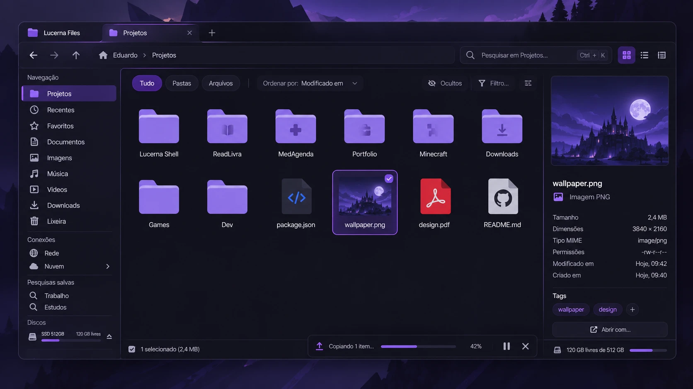

# Rascunho da GUI

Rascunho da janela do `lucerna-files-gui` (v2), com o que já está de acordo com o [spec](superpowers/specs/2026-10-27-explorador-design.md) e o que falta mudar antes da próxima versão.

## O que já está certo

- **O título e as abas estão numa linha só, sem botões de janela.** Isso combina com o Hyprland e economiza uma linha.
- **A aba, o caminho e a lateral concordam:** os três mostram Projetos. O caminho "🏠 Eduardo › Projetos" ficou limpo.
- **A lateral está completa:** Conexões, Pesquisas salvas e Discos com capacidade e botão de ejetar.
- **A fila aparece na janela** com progresso, pausar e cancelar. É o que importa para quem usa sem o shell.
- **A barra de status** mostra "1 selecionado (2,4 MB)".
- **A prévia é útil:** dimensões, MIME, permissões, data de criação e "Abrir com...".
- **Há controles de ordem, ocultos e filtro.** A seleção tem uma marca (✓) separada da borda, o que distingue foco de seleção.

## O que falta mudar

1. [ ] **Pasta pessoal na lateral.** "Início" (a pasta pessoal) deve ser o primeiro item de "Navegação"; hoje só sobrou o ícone 🏠 no caminho.
2. [ ] **Ícones sem marcas, em Material Symbols.** Trocar o ícone do GitHub no `README.md` e o da Adobe no `design.pdf`. Padronizar os glifos das pastas: em ReadLivra, Portfolio e Minecraft eles aparecem apagados, Games e Dev não têm glifo, e o do Minecraft lembra o creeper.
3. [ ] **Painel duplo e Miller.** Pôr um botão de "dividir" ao lado das visões (ou pelo menos no menu). Se o terceiro botão de visão for Miller, o ícone precisa deixar isso claro.
4. [ ] **Menos filtros sobrepostos.** Os chips Tudo/Pastas/Arquivos, o "Filtro..." e a busca se sobrepõem. O spec separa o **filtro ao vivo na pasta** da **busca recursiva**. Os chips vão para dentro do Filtro, e o ícone de controles deslizantes à direita sai (não diz o que faz).
5. [ ] **Atalhos.** Ctrl+F para buscar, Ctrl+K (ou Ctrl+Shift+P) para a paleta de comandos e `/` no modo Vim. O mesmo atalho vale na TUI, porque o catálogo de ações é um só. A paleta precisa ter algum sinal na janela.
6. [ ] **"Ocultos" com estado visível.** O olho cortado é ambíguo ("ocultos escondidos" ou "clique para esconder"); deve ser um botão liga/desliga com estado visível, como os chips.
7. [ ] **Fila com vários estados.** Desenhar:
   - várias operações ao mesmo tempo ("3 operações · 42%", que abre a fila completa ao clicar);
   - **conflito**, com o pedido de resposta chamando atenção;
   - operação **interrompida** depois de uma queda, com "Retomar" e "Cancelar".
8. [ ] **Espaço livre num lugar só.** Hoje aparece na lateral e no canto da barra de status, e o texto da lateral ("SSD 512GB 120 GB livres") é pequeno demais para ler. Deixar só um dos dois.
9. [ ] **Prévia de imagem.**
   - Pôr "Definir como papel de parede", que só aparece com o shell presente.
   - "Criado em" depende do sistema de arquivos (btime pelo `statx`); quando não existir, a linha some, sem mostrar "—".
10. [ ] **Etiquetas.** No spec elas são v4. Ou ficam marcadas no rascunho como futuro, ou o spec as adianta para a v2.
